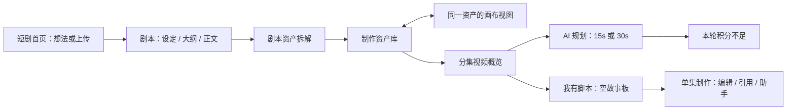
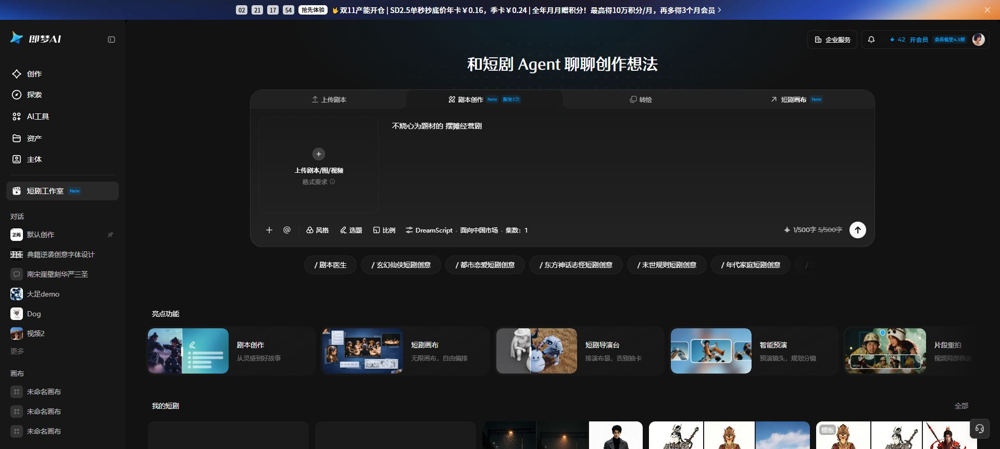
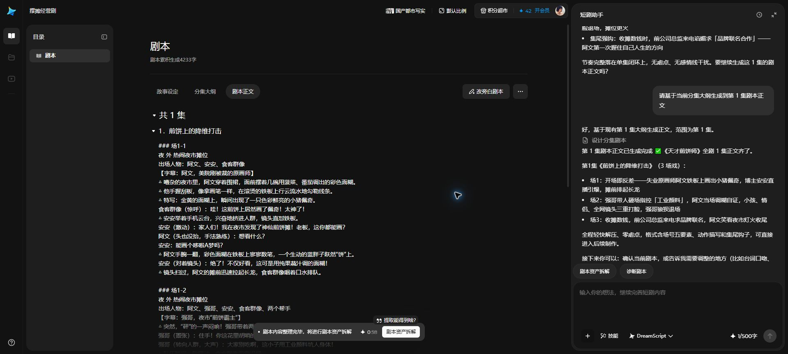
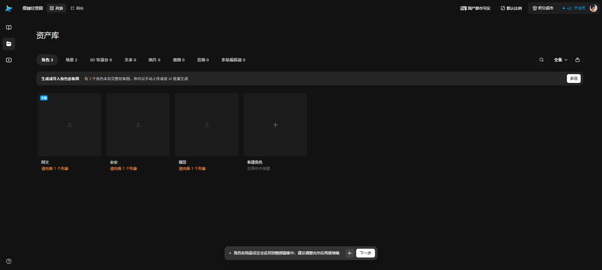
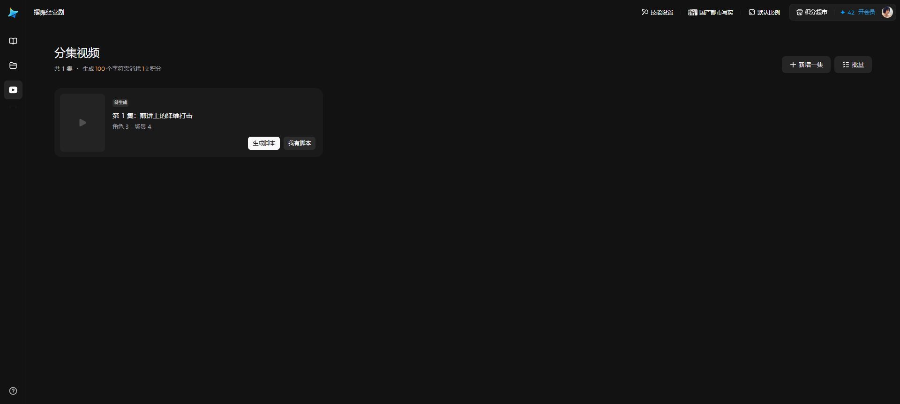
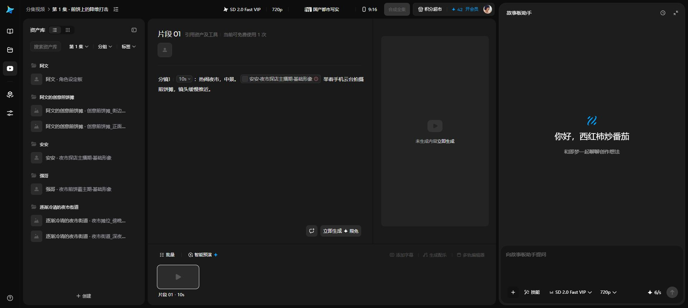

# 即梦短剧工作室：从首页到制作页的实操记录

日期：2026-11-03（Asia/Shanghai）。从用户指定的已登录 Chrome 标签页与已填内容继续，全部证据来自本轮操作。此记录用于下一轮重构，**不代表本地工作台已完成这些改造**。

## 结果和边界

即梦以“短剧首页 → 剧本 → 制作资产库 → 分镜”组织工程。首页导航管理跨项目入口；工程侧栏表达当前创作阶段。复杂能力在阶段内按需展开。只复制单集制作的三栏布局，会保留原内容库、资产库、工坊各自独立的操作负担。

本次新建“摆摊经营剧”，projectId=13573784997644。保留用户输入“不烧心为题材的 摆摊经营剧”，助手将其理解为不虐心；选择国产都市写实、DreamScript、国内剧本、本次 1 集。已生成故事设定、大纲和第 1 集正文，累计 4233 字，第 1 集《煎饼上的降维打击》，3 场戏；资产拆解得到 3 个角色、2 个父场景。

AI 分镜规划因积分不足失败。随后经“我有脚本”手动分支创建故事板，保存 1 个 10 秒、带安安造型引用的演示片段。没有执行角色/场景出图、视频生成、合成或导出。

[本次实操项目](https://jimeng.jianying.com/novel/edit?projectId=13573784997644&storyboard_asset_id=13575195560972&overviewPippitAssetId=13574145021708)

## 实测步骤

| 步骤 | 页面和实际行为 | 状态 | 证据编号 |
| --- | --- | --- | --- |
| 1 首页 | /ai-tool/novel：上传剧本、剧本创作、转绘共用输入卡片，另有短剧画布；风格、选题、比例、集数收在底部工具及浮层，下方是技能、亮点功能和我的短剧。 | 正常 | 01–04、07–08 |
| 2 建立项目 | 提交想法跳 /novel/detail/script 并产生 projectId。首页侧栏换成剧本、制作资产库、分镜的 56px 阶段轨道；后两项禁用。中央是目录和剧本文档，右侧短剧助手。 | 正常 | 05 |
| 3 创作剧本 | 助手给 3 个方向，再确认核心方案；中央依次产出故事设定、大纲、正文。底部只给当前下一步，可选直出全剧正文。按钮直接向助手发送对应请求。 | 正常 | 06、10–12 |
| 4 资产拆解 | 正文完成后主动作变为剧本资产拆解。说明弹层介绍角色造型、场景视角和匹配；执行后自动进入 /novel/detail/scenes，并创建 canvasId。分析时是独立等待态。 | 正常 | 13–14 |
| 5 完善资产 | 默认角色/场景卡，提示缺失形象或子场景图；点击角色卡跳 /novel/detail/canvas，并由 highlightNodeIds 定位同一实体。列表与画布互通。缺图提醒允许继续。 | 正常，缺图可继续 | 15–19 |
| 6 分集视频 | /novel/detail/video：第 1 集卡片、角色 3、场景 4；主动作生成脚本或我有脚本。AI 规划先选 15s/30s 上限，选定不可修改；本次选 15s，等待后积分不足失败。 | 页面正常，AI 规划受阻 | 20–23 |
| 7 手动制作 | 我有脚本会创建空故事板，跳 /novel/edit；默认占位片段 01 为 10s。手动输入 @ 引用本集角色；保存后返回概览显示分镜视频 0/1，主动作改为编辑。 | 正常，原 AI 失败提示仍残留 | 24–30 |
| 8 全局资产/恢复 | /ai-tool/asset 分生成历史、画布、短剧工作室。项目卡在新标签页打开同一 projectId，带 auto_jump=1。本轮在正文完成后重新进入，恢复到剧本正文 Tab。 | 正常；未验证所有阶段恢复规则 | 09、12 |

## 功能与交互细节

### 两层导航和两层资产

首页侧栏是创作、探索、AI工具、资产、主体、短剧工作室，以及历史会话和画布；工程内主导航则是三个制作阶段。新工程自动出现在我的短剧和全局资产项目卡中。

全局资产的生成历史还分图片、视频、音频、文档。它管理跨项目成果，不等于当前工程制作资产库。上传剧本可上传或粘贴，粘贴弹层上限 100000 字；本轮只查看入口，没有再提交上传项目。新开首页默认显示 10 集，用户原页为 1 集，不能把用户选择推断成统一默认。

### 解锁与状态

创建时只启用剧本；完成设定、大纲、正文并不直接开放资产库。执行拆解进入分析页，完成后分镜可用。资产图片不完整是软提醒，允许继续，不要求全部出图才能制作。

剧本页主动作依次为生成故事设定、生成分集大纲、生成第 1 集、剧本资产拆解；同一文档与助手共同承接这些操作。用户不需要理解转入、同步、解析、规划等接口差异。

分集卡片须区分没有分镜脚本、规划中、规划失败、已有故事板和视频完成度。本次手动故事板保存后显示 0/1 和编辑，但旧积分不足提示仍在，应改进而非照搬。点击卡片中的角色/场景统计也进入单集编辑，本轮没有观察到它跳到资产筛选。

### 列表和画布共用资产

实际类型标签为角色、场景、3D导演台、文本、图片、视频、音频、多轨编辑器；本轮未见独立道具 Tab。3 个角色各待完善 1 个形象。2 个父场景卡各提示 2 个子场景图，分集卡统计场景 4。

点阿文卡片打开同一 canvasId=13574612397068 的画布并定位角色。初始 12 个节点；点击角色设定板模板后增加到 15，新增角色档案与参考图并连接生成节点，模型/比例/分辨率/提示词只在生成面板展开后出现。本轮显示 Seedream 5.0 Pro、9:16/1K、6 积分，但未按下生成。文本和图片标签各增加 1，是模板空节点，不能当作真实媒体。

角色模板操作保留在本次新建演示工程，没有修改用户既有短剧项目。资产拆解说明报价显示 0.58 积分；本轮未核对账单，报价只作当时界面快照。

### AI 和手动共用工作区

剧本阶段默认显示短剧助手；单集制作默认收起故事板助手。右下与 AI 对话展开助手时，当前正文、资产和片段仍在同一页面，布局随助手宽度变化；不进入另一套互斥的 AI 页面。

@ 菜单有资产、小工具两个 Tab；资产按角色、场景、素材组织，也可展开全剧资产和短剧全局资产。选安安后正文存造型引用，标题下出现引用项；图片未制作会显示缺图状态，不伪造缩略图。

小工具实际可见添加时间、运镜、片段续接、首尾帧参考。后续本地实现应依后端工作流能力呈现，不把即梦专属能力照搬成不可执行按钮。

手动演示正文为“热闹夜市，中景。[安安造型引用] 举着手机云台拍摄煎饼摊，镜头缓慢推近。”返回概览并再次进入后内容仍存在，验证了保存和恢复；未点击立即生成。手动创建时全局比例由默认变为 9:16，本轮没有主动改比例。

### 高级功能入口

分镜页技能设置打开独立弹层，分 AI 生成剧本、资产设计、分镜设计三个阶段；前两项显示即将上线，本轮分镜配置为 0，未新建或应用配置。不能把可见入口当作全部功能已可用。

字幕、配乐、多轨编辑器和合成在本次未出片状态下禁用。3D导演台、智能预演等仅观察入口，未执行。

## 对本地工作台的重构建议（尚未实施）

| 当前结构/行为 | 建议 | 依据 |
| --- | --- | --- |
| /director 先选模式、制作配方、创建空工程 | 首页直接输入创意或上传；风格/比例/集数渐进设置，提交后进入剧本 | 步骤 1–2 |
| 内容库同时呈现文档、解析摘要、六类结果 Tab 和转入/规划/同步按钮 | 改为剧本工作区：目录、设定/大纲/正文、右侧助手；上传剧本直接展示正文 | 步骤 2–3 |
| 多个功能模块并列，只有 workshop 使用紧凑壳 | 全工程统一项目壳，以剧本、制作资产库、分镜制作为主阶段；剪辑、任务和配方放相应工具或详情 | 三阶段导航 |
| 转入资产、规划出片镜头、同步工坊分别操作 | 用下一步承接现有接口，保持同一项目/文档/分集/资产 ID；让用户只理解拆解资产和进入分镜 | 步骤 4–6 |
| 资产表单密集，详情和画布分离 | 默认简洁卡片，体现造型、视角、出现集数、就绪状态；点卡定位同一资产的画布或详情，生成设置按需展开 | 步骤 5 |
| AI生成/手动编辑切换不同项目面板 | 统一可编辑工作区，助手按阶段展开/收起，AI 产物回写同一数据 | 步骤 3、7 |
| 最近工程始终跳 content | 保存有效阶段与分集上下文，按已有成果或最后位置恢复 | 当前 Director2StudioHome.handleOpen 固定 content，与步骤 8 不同 |
| 规划失败与制作状态混用，技术错误直接暴露 | 分别呈现规划任务、资产缺失、片段生成状态，并提供可继续的下一步 | 步骤 4、6、7 |

现有工程已经有资产与成片时应直接承接，不强制重走向导，不重新调用模型，不覆盖原资产或视频。保留现有后端、队列和供应商能力；前端仍统一根主题和 Ant Design。对话创作室视觉继续遵循项目要求的官方组件 token，本轮主要确定流程和数据承接。

建议顺序：先冻结短剧首页、剧本工作区、制作资产库三页与统一项目壳，再接阶段状态和现有接口编排，最后把已有单集制作页纳入流程并补行内工具。不要继续只精修单集页。

## 体验与无障碍观察

- 阶段禁用态、下一步主动作、缺图状态、异步等待反馈，能减少用户判断操作的负担。
- 分镜规划等待后才报告积分不足，应尽可能前置说明消耗。手动成功后仍显示旧规划失败，状态需分开。
- 场景缺图弹层的标题和正文角色措辞不完全一致；造型名称和模板工具名宜分开管理，避免引用名称变成工具名。
- 画布部分节点内部控件未在本轮可访问树中暴露常规按钮，需要鼠标定位；本地实现应保留可访问标签、键盘入口、焦点和文字状态。小图标不应只靠颜色或图形传递含义。
- 本轮仅桌面检查，不含移动端、完整键盘/读屏覆盖，不能据此声称无障碍合规。

## 证据与未验证范围

30 张桌面过程截图，1920×863。14 是明确的分析等待态，23 是失败态，25 是手动空态；不当作成功生成证据。截图已观察，关键图从保存文件重新打开核对。目录和本文件按现有 docs/design-ref-director/* 规则保存在本地，未修改 .gitignore。

本轮只新增实操资料并更新导演台流程索引，未改业务代码、API、数据库、ComfyUI 或既有任务，因此没有重跑前后端构建。

未得到 AI 分镜规划成功输出；未验证角色/场景真实出图、片段生成、成片播放器跨段播放、合成、导出、字幕、配乐、多轨编辑器和全部技能执行。仅验证过一次正文阶段的项目卡片恢复，不推断所有阶段的恢复规则。

## 截图索引

| 文件 | 含义 |
| --- | --- |
| [01-home-script-filled.jpg](01-home-script-filled.jpg) | 已填写内容的首页 |
| [02-script-generation-settings.jpg](02-script-generation-settings.jpg) | 生成设置 |
| [03-missing-style-confirmation.jpg](03-missing-style-confirmation.jpg) | 缺少风格提醒 |
| [04-style-library.jpg](04-style-library.jpg) | 风格库 |
| [05-project-script-agent-direction.jpg](05-project-script-agent-direction.jpg) | 新项目与创意方向 |
| [06-story-concept-confirmation.jpg](06-story-concept-confirmation.jpg) | 方案确认 |
| [07-home-upload-script-entry.jpg](07-home-upload-script-entry.jpg) | 上传剧本入口 |
| [08-home-paste-script-dialog.jpg](08-home-paste-script-dialog.jpg) | 粘贴文本 |
| [09-global-assets-short-drama-projects.jpg](09-global-assets-short-drama-projects.jpg) | 全局资产项目列表 |
| [10-story-setting-document.jpg](10-story-setting-document.jpg) | 故事设定已保存 |
| [11-episode-outline-next-action.jpg](11-episode-outline-next-action.jpg) | 大纲和下一步 |
| [12-script-body-and-breakdown-entry.jpg](12-script-body-and-breakdown-entry.jpg) | 正文和资产拆解入口 |
| [13-breakdown-explanation-and-action.jpg](13-breakdown-explanation-and-action.jpg) | 拆解说明 |
| [14-assets-stage-analysis-progress.jpg](14-assets-stage-analysis-progress.jpg) | 资产分析等待态 |
| [15-project-assets-roles.jpg](15-project-assets-roles.jpg) | 角色列表 |
| [16-role-card-opens-focused-canvas.jpg](16-role-card-opens-focused-canvas.jpg) | 角色定位画布 |
| [17-role-template-generation-panel.jpg](17-role-template-generation-panel.jpg) | 角色模板生成面板 |
| [18-project-assets-scenes.jpg](18-project-assets-scenes.jpg) | 场景及子场景状态 |
| [19-missing-assets-continue-warning.jpg](19-missing-assets-continue-warning.jpg) | 缺图允许继续 |
| [20-episode-overview-before-shot-script.jpg](20-episode-overview-before-shot-script.jpg) | 无分镜脚本时的概览 |
| [21-shot-script-planning-15s-or-30s.jpg](21-shot-script-planning-15s-or-30s.jpg) | 15/30秒规划 |
| [22-advanced-workflow-skill-dialog.jpg](22-advanced-workflow-skill-dialog.jpg) | 高级技能配置 |
| [23-shot-script-insufficient-credits.jpg](23-shot-script-insufficient-credits.jpg) | 积分不足失败 |
| [24-manual-storyboard-entry-confirmation.jpg](24-manual-storyboard-entry-confirmation.jpg) | 手动故事板确认 |
| [25-manual-storyboard-empty.jpg](25-manual-storyboard-empty.jpg) | 空故事板 |
| [26-storyboard-asset-and-tool-picker.jpg](26-storyboard-asset-and-tool-picker.jpg) | 资产和工具选择器 |
| [27-inline-prompt-tools.jpg](27-inline-prompt-tools.jpg) | 行内小工具 |
| [28-manual-edit-with-storyboard-assistant.jpg](28-manual-edit-with-storyboard-assistant.jpg) | 手动编辑和助手 |
| [29-episode-overview-manual-storyboard.jpg](29-episode-overview-manual-storyboard.jpg) | 已保存后的0/1和编辑 |
| [30-storyboard-saved-manual-reference.jpg](30-storyboard-saved-manual-reference.jpg) | 重新进入内容仍在 |

## 关键页面实拍

首页：

剧本文档：

制作资产库：

分集概览：

手动故事板与助手（不是出片结果）：

## 2026-11-03 补充：制作资产与专属短剧画布

按用户提供的即梦项目与专属空画布实际操作。项目资产卡把同一 projectId/canvasId 的角色或场景定位到画布，角色档案/人物参考图连接形象输出；场景有各自机位和命名弹层。形象名称、造型/出场集、音色在紧凑弹层内操作，点空图片或新建角色出现底部创作面板。工具箱确有角色换装、场景多机位、局部重拍、氛围切换、角色多视图、480P 超分；只检查入口，未在即梦提交付费生成。

专属短剧画布 `canvasId=13590145093900&canvasDraft=1` 初始 0 节点。点击「角色设定板」建立 4 个节点（组、档案、人物参考、形象），左侧资产列表同步出现，空画布自动绑定项目；地址新增 `projectId=13586094912524`、标题为「未命名」。这说明独立画布与项目资产共享实体，不能复制成两份互不同步的数据。测试后聚焦画布撤销恢复 0 节点；原项目的新增空角色也撤销恢复 17 节点，没有消耗生成积分。原已被其他聊天占用的项目标签未接管；项目调研使用独立标签，专属空画布按用户新提供标签操作。

本地采用同一资产 ID 派生节点、列表聚焦组、独立档案/参考/图片与底部提示词面板的方式。只展示已有平台能力，未把即梦尚未接入的 3D/超分等工具做成空按钮。

| 参考图（`asset-canvas/`） | 实际观察 |
| --- | --- |
| `01-jimeng-character-canvas.png` | 档案、人物参考与角色形象连线 |
| `02-jimeng-character-metadata.png` | 形象与出场信息的紧凑弹层 |
| `03-jimeng-toolbox.png` | 6 项创作模板工具 |
| `05-jimeng-scene-canvas.png` / `06-jimeng-scene-metadata.png` | 场景组、多机位与名称编辑 |
| `07-jimeng-generation-composer.png` | 新节点与底部提示词面板 |
| `08-jimeng-standalone-empty.png` | 用户专属短剧空画布 |
| `09-jimeng-standalone-character-template.png` | 模板创建角色组，资产库同步 |

### 2026-11-03 补充：画布空白处右键

用户提供的专属空白画布实测：右键先出现「添加节点 / 上传 / 从即梦资产库选择 / 粘贴 / 撤销 / 重做」，点击「添加节点」展开角色、场景、3D 导演台、文本、图片、视频、音频、多轨编辑器。本次只查看菜单并关闭，仍为 0 节点，没有提交生成。参考图为 `asset-canvas/10-jimeng-context-add.png`。

本地复用现有资产实体，在右键菜单中提供角色/场景/道具及现有资产库、适应全部操作；沿用统一创建弹层并按点击位置建组。未加入未实现的通用节点、剪贴板或撤销菜单占位。

### 2026-11-03 补充：分集视频底部批量条

从用户提供的分集编辑链接另开独立参考页实测（未占用其他对话标签）：缩略图 114×64px、圆角 8px，图间距 10px；标题 114×20px，与图相隔 8px。批量按钮 76×28px、生成/删除各 68×28px，圆角 6px，操作间距 8px。角标点击区 20×20px，距图右上各 6px，内部 16×16px、圆角 4px、黑色 60% 透明底和白勾；勾选描边为图内 1px。

进入批量从 0 选择开始；只给已勾选片段描边，当前预览未勾选时无框。全选了全部片段时删除禁用，悬停实际提示「至少保留 1 个片段」。此次只选中/取消并截图，未提交生成或删除；研究结束已退出批量。截图：`workshop-batch/reference-selected.png`。本地继续使用根主题色，不复制即梦账号与积分区域。
