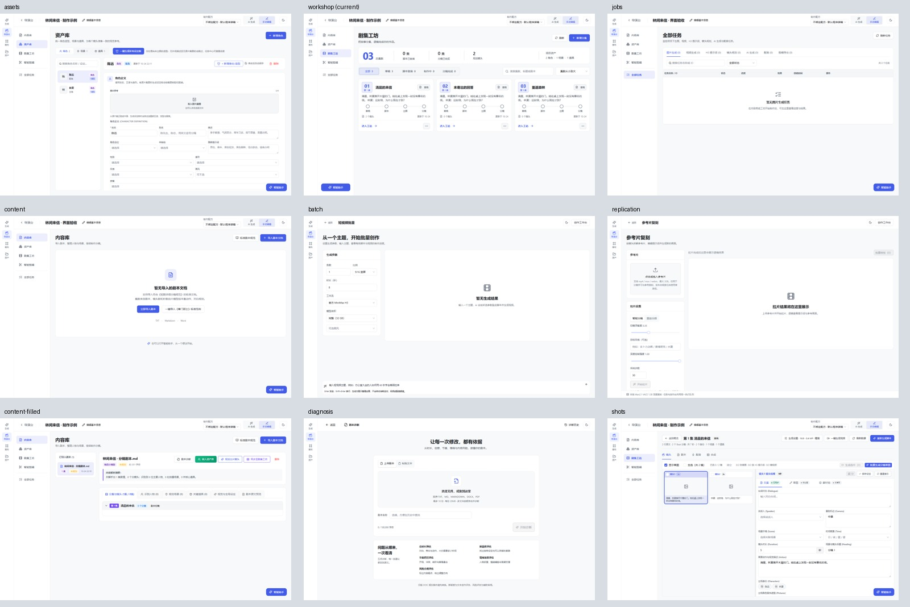

# 导演台子页面 UI 验收 · 2026-10-25

已沿用原有浅暗主题与靛蓝主色，完成先设计、再实现、真实桌面页面对照与操作验证。验收入口为 `http://127.0.0.1:5173`。

交付复核时，工作树中的工坊概览已采用同期独立的[多集短剧设计稿](../series-ui-20261025/DESIGN.md)。本报告保留首轮冻结稿与实现对照，同时另存当前概览的[浅色](current-workshop-light.png)、[暗色](current-workshop-dark.png)及[新增弹层](current-workshop-modal-dark.png)，避免把首轮工坊对照当作新版的逐像素证据。其余子页面仍以本报告的冻结稿为准。

## 设计与实现

设计开始于 2026-10-24。先用内置 ImageGen 生成[主页面探索图](concept-core.png)和[专用工作室探索图](concept-specialists.png)，再将真实业务内容、Ant Design 控件与尺寸约束落实为逐页冻结稿，之后修改业务源码。生成提示词见 [PROMPTS.md](PROMPTS.md)，规格见 [DESIGN.md](DESIGN.md)。

资产库首轮发现 Ant Design 6 的 Spin 包装结构使独立滚动意图未成立，先修订并冻结 v2 图，再修改源码。资产库以 `design-assets-v2-*` 为准；首版原图保留作历史。当前仓库已下线 Hypit，其设计只作归档。

| 页面 / 状态 | 设计稿（浅色） | 实现（浅色） | 同坐标对照 |
| --- | --- | --- | --- |
| 内容库空态 | [设计](design-content-light.png) | [实拍](actual-content-light.png) | [左设计 / 右实现](comparisons/content-light.jpg) |
| 内容库有文档 | [设计](design-content-filled-light.png) | [实拍](actual-content-filled-light.png) | [对照](comparisons/content-filled-light.jpg) |
| 资产库 | [v2 设计](design-assets-v2-light.png) | [实拍](actual-assets-light.png) | [对照](comparisons/assets-light.jpg) |
| 工坊概览（首轮） | [设计](design-workshop-light.png) | [首轮实拍](actual-workshop-light.png) | [首轮对照](comparisons/workshop-light.jpg) |
| 分集镜头工作区 | [设计](design-shots-light.png) | [实拍](actual-shots-light.png) | [对照](comparisons/shots-light.jpg) |
| 全部任务 | [排版稿](design-jobs-light.png) | [真实控件实拍](actual-jobs-light.png) | [对照](comparisons/jobs-light.jpg) |
| 短视频批量 | [设计](design-batch-light.png) | [实拍](actual-batch-light.png) | [对照](comparisons/batch-light.jpg) |
| 参考片复刻 | [设计](design-replication-light.png) | [实拍](actual-replication-light.png) | [对照](comparisons/replication-light.jpg) |
| 剧本诊断 | [设计](design-diagnosis-light.png) | [实拍](actual-diagnosis-light.png) | [对照](comparisons/diagnosis-light.jpg) |

每行均另有对应 `*-dark.png` 和 `comparisons/*-dark.jpg`，见[暗色实现总览](implementation-overview-dark.jpg)及[完整文件索引](evidence/artifact-index.json)。

## 同视口还原验证

18 张基准实拍均为 **1600×1000、DPR 1、CSS 像素截图**，与各自冻结稿同尺寸。采集等待真实工程、文档、资产与分集加载完成，字体就绪后移开指针并冻结动画。加载态和弹层进出动画中的无效截图未进入本报告。

用 `measure_reference.py → prepare_capture.py → collect.js → verify_capture.py` 完成三组精确测量，15 个区域的最大外框偏差均为 **0 CSS px**：

| 页面 | 区域数 | 测量范围 | 证据 |
| --- | ---: | --- | --- |
| 内容库 | 4 | 顶栏、导航、页头、空态面板 | [几何报告](evidence/content/geometry.md) |
| 资产库 v2 | 7 | 顶栏、导航、页头、分类、工作区、名单、详情 | [几何报告](evidence/assets/geometry.md) |
| 短视频批量 | 4 | 顶栏、页头、双栏、结果区 | [几何报告](evidence/batch/geometry.md) |

各组归档包含原图标注、测量、真实 DOM 采集、候选截图和验证结果；[汇总数据](evidence/geometry-summary.json)。其余页面均有整页同坐标叠置式差分与双图对照，18 组图片的尺寸、哈希、像素差和差异范围见[图像比较记录](evidence/image-comparisons.json)。差异值用于定位变化，不换算还原率。

浏览器 CDP 确认浅暗主题的中文页面标题实际由 **Microsoft YaHei / MicrosoftYaHei-Bold** 渲染。[字体记录](evidence/interactions.json)

## 桌面与操作验证

另采集 **44 张桌面浅暗截图**：1440×900 和 1920×1080，各覆盖上述九种状态及首页、智能剪辑。44 次采集均无文档横向溢出、JavaScript `pageerror` 或失败的 API 响应。[采集记录](evidence/desktop-matrix.json)

首页归档使用搜索只显示临时样例工程。智能剪辑与助手保留既有布局与设计体系，复验入口及浅暗显示；本轮没有重绘对话组件内部样式。

**26 组独立操作检查全部通过**，覆盖以下路径：[逐项结果](evidence/interactions.json)

- 资产分类与搜索、清空恢复、键盘选中、独立滚动、新增弹层取消；实际自动保存请求成功，刷新后恢复修改，再恢复原名。
- 任务名称与 ID 查询、首尾空格与大小写、完成 / 取消状态别名、清空筛选、类型切换、无结果恢复和任务详情开关。延迟首次列表响应的定向验证证明，用户选中的类型不会被初次初始化覆盖。
- 内容库导入与规范弹层、六类内容页签及原生溢出菜单、键盘选择文档。
- 工坊通过键盘进入分集，镜头 / 剧本 / 配音 / 合成四 Tab、文案 / 草图 / 素材组检视、生成设置弹层与返回概览。
- 诊断粘贴与历史抽屉、批量工作流下拉、复刻智能 / 固定分段与必需参考片的按钮状态。

当前工坊新版另外完成浅暗两组检查：搜索、制作状态筛选、取消新增弹层与键盘进入分集均通过；1600×1000 及两种补充桌面尺寸共六张主页面实拍无横向溢出、运行异常或失败 API。[主页面记录](evidence/current-workshop-check.json)、[操作与桌面记录](evidence/current-workshop-interactions.json)。这些检查不计入首轮 26 组或 44 张截图。

## 测试结果

| 检查 | 结果 |
| --- | --- |
| `pnpm --dir frontend build` | 交付复核为 63 个测试文件、429 项测试、TypeScript 与 Vite 构建通过；首轮为 62 文件 / 423 项 |
| `python -X utf8 -m unittest backend.tests.test_director_project_info backend.tests.test_director2_ai_generation -q` | 51 项通过 |
| Impeccable 机械检查 | 本轮目标输出 `[]` |
| 设计 / 桌面 / 交互汇总 | [结构化验收摘要](evidence/validation-summary.json) |

复核的原始命令输出：[前端构建](evidence/frontend-build-current.txt)、[后端测试](evidence/backend-tests-current.txt)。

Vite 仍提示部分产物超过 500 kB；浏览器可见现有 Ant Design Modal 废弃属性提示。这些提示不属于本轮新增界面行为，也未计作 JavaScript 运行错误。

## 原稿差异与边界

- 任务排版稿中的示意输入、下拉与 Film 空态图标，按项目规则采用真实 Ant Design Input / Select 与语义明确的 ListChecks；空态随当前类型显示。无任务时默认图片生成，有记录时按最新类型初始化。这些控件与动态文案差异已在对照中保留。
- 分集 Tab 使用实际 lucide 图标；批量与复刻空态同样采用库中 Film 图标，区别于原型的近似线条。
- 全局滚动条沿用当前仓库 2026-10-25 的悬停显示规则，时间戳、选择状态和测试数据变化不作为布局误差。常规工作室继承根级控件尺寸，紧凑项目表单以 36px 为基线。
- 本轮验证 UI 与保存、筛选等路径，人工样例没有入队 LLM、出片、转写或视频理解。当前仅覆盖桌面。测试数据与会话清理记录见[清理结果](evidence/cleanup.json)。

## 兼容与回滚

继续使用现有项目、文档、资产、分集、任务、制作配方、生成设置和根级主题接口；新增任务筛选为当前页面的视图状态。没有新增依赖、API 或数据库迁移。

仅逆向撤回本轮子页面 UI 增量并重新构建即可回滚；保留用户同期的首页、生成页、缓存、后端和其他未提交修改。受影响文件与完整步骤见[架构记录](../../ARCHITECTURE.md#2026-10-25-导演台子页面设计与还原)。
