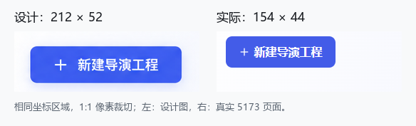
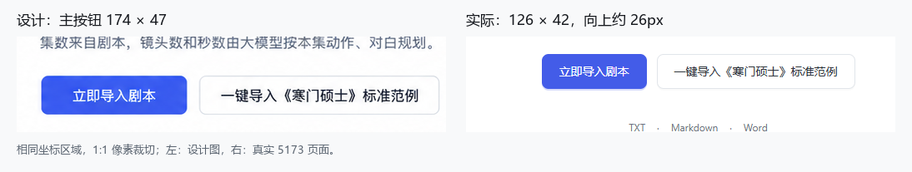

# 界面还原效果复核 · 2026-10-24

> 本页保留修正前的复核事实。F1–F3 已在后续细节校准中修复，最新结论与同坐标三联图见[细节校准验收](../details-20261024/REPORT.md)。

**结论：结构基本还原，视觉细节未通过。** 原验收记录中的最大 12px 只覆盖主要容器外框，不能代表内部控件已还原。此次补测按钮、图标、文字组与工具栏后，发现三处明显差异。

本轮在真实 `http://127.0.0.1:5173` 页面重新采集 8 张截图。设计对照使用 1505×1045、DPR 1；另外查看 1440×1000 浅色与 1920×1080 暗色。字体与图片就绪、页面身份和截图尺寸均核对，无页面横向溢出和浏览器运行异常。未修改应用代码。

## 需修正的三处差异

| 优先级 | 位置 | 设计图 | 当前实现 | 判断 |
| --- | --- | --- | --- | --- |
| P2 | 首页「新建导演工程」 | 212×52px | 154×44px | 宽度少 58px，主操作的视觉分量偏小 |
| P2 | 内容库「立即导入剧本」 | 174×47px，约 y=597 | 126×42px，y=571 | 宽度少 48px，向上约 26px；内容组比例与间距仍需校准 |
| P2 | 首页最近工程的搜索工具栏 | 搜索框约 x=732 | x=809.5 | 向右偏移约 78px，筛选控件整体也比设计紧凑 |

设计按钮边界由蓝色实填像素提取，截图抗锯齿可能产生约 1px 的边界差异；搜索框边界为人工栅格标注，约 ±2px。实际控件来自浏览器 DOM 测量。以上差异显著大于这些测量误差。

建议按“字号与控件尺寸 → 内边距 → 内容组位置”的顺序校准；不要只给内容块追加位移，否则按钮比例与工具栏宽度仍会不一致。对应代码位于 `director-home.css:51/64/75`、`panes/content-library.css:44/57/58/60`。

### 首页主按钮

### 内容库按钮组

### 搜索与类型筛选

## 已符合的部分

- 首页主次入口、剧本诊断、三列工程卡及项目侧栏的总体结构接近设计；主要外框偏差仍处于先前记录的范围。
- 浅暗主题表面层级正常，当前复核未发现此前的暗色白底和深色标题问题。
- 浏览器实际中文字形使用 Microsoft YaHei；不把生图字体的栅格字形差异误判为错误字体。工程数量、标题和时间等真实数据变化不计为还原缺陷。

本轮是视觉验收，未重新执行上轮 106 项交互测试或修改业务功能；原有功能检查通过记录继续保留，但整体视觉验收结论以本复核为准。

## 原始证据

[测量与条件记录](capture.json) · [差异清单](review.json)

| 页面 | 1505 浅色 | 1505 暗色 | 1440 浅色 | 1920 暗色 |
| --- | --- | --- | --- | --- |
| 首页 | [截图](home-light-1505.png) | [截图](home-dark-1505.png) | [截图](home-light-1440.png) | [截图](home-dark-1920.png) |
| 内容库 | [截图](project-light-1505.png) | [截图](project-dark-1505.png) | [截图](project-light-1440.png) | [截图](project-dark-1920.png) |

内容库使用临时空工程匹配设计状态，工程已通过真实 API 删除；测试账号、会话、临时脚本和认证文件在复核结束后清理。没有提交生成、配音或转写任务。
